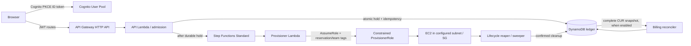

# SPENDCTL architecture and behavior

## Scope and verification labels

This document describes the implementation in source and synthesized infrastructure. **Implemented** means source exists; **Locally verified** means a named test or local check covers it; **AWS verified** requires an actual account execution and saved evidence. The first two labels do not imply the third. As of this document, no end-to-end AWS run is recorded, so the live path is not AWS verified.

## Request and resource lifecycle



The diagram describes the intended code path. AWS credentials, deployed resources, and service behavior are not inferred from it.

| Transition | Input → output and source | Persisted state / idempotency | Failure behavior and budget effect | Local evidence |
|---|---|---|---|---|
| Browser → Cognito → API | Browser starts authorization-code + PKCE; API Gateway validates JWT. `frontend/src/auth.ts`, `frontend/src/api.mjs`, `infra/stacks/foundation.py` (`IdentityStack`, `ApiStack`) | Cognito subject and `custom:team`/`team` claim are taken from trusted authorizer context in `services/spendctl/api.py`; request-body team is not identity proof. | Invalid/missing claims are rejected. A real browser login, CORS path, and JWT acceptance remain unverified in AWS. | `tests/unit/test_api.py::test_missing_or_non_developer_claims_are_rejected`, CDK template assertions in `tests/unit/test_m9_m11_infra.py` |
| API → admission | `POST /v1/requests` with request body and `Idempotency-Key`; validates team against verified identity, estimates, applies reserve multiplier. `services/spendctl/api.py`, `services/spendctl/admission.py` | Reservation id is deterministic from team, subject, and idempotency key; estimate and price snapshot are recorded. | Validation, team mismatch, insufficient budget, and conflicting key fail without creating an extra hold. | `tests/unit/test_api.py::test_create_request_idempotency_and_conflict`; `tests/unit/test_pricing_admission.py::test_admission_reserves_atomically_and_replay_is_durable` |
| Admission → DynamoDB | One DynamoDB transaction writes the idempotency record and reservation and subtracts `available_micro` while adding `reserved_micro`. `services/spendctl/ledger.py::DynamoLedger.reserve` | Reservation and idempotency rows share `Reservations`; conditional writes and a stable fingerprint detect replay/conflict. | Known failure is reported for retry; ambiguous reserve is reconciled using the same identity, otherwise remains unknown. No workflow starts until durable reserve is confirmed. | `tests/unit/test_ledger.py::test_budget_create_and_reserve_replay_are_idempotent`; `tests/unit/test_pricing_admission.py::test_ambiguous_reserve_is_unknown_and_never_released_or_started` |
| Durable hold → workflow | API invokes `WorkflowStarter.start`; deterministic execution name and persisted start intent support recovery. `services/spendctl/api.py`, `services/spendctl/workflow_start.py` | Start state, execution identity/status, and reservation are persisted. Same name/input is reconciled after ambiguous response. | A definitive rejection can release only after confirmed failure and durable no-resource evidence. Unknown start keeps the hold. | `tests/unit/test_api.py::test_ambiguous_workflow_start_stays_unknown_and_keeps_reservation`; `tests/unit/test_core.py::test_duplicate_execution_name_reconciles_matching_input_and_status` |
| Workflow → provisioner → EC2 | Standard workflow invokes callback/provisioner Lambdas. Provisioner assumes `ProvisionerRole` with `reservation-id` and `team` session tags; launches exactly one approved instance with no public IP, no key pair, IMDSv2, and encrypted delete-on-termination gp3. `infra/stacks/foundation.py`, `services/spendctl/provisioner.py` | Resource IDs, launch state, and ownership tags are recorded. EC2 client token is the reservation ID. | Caller and trust policies constrain session tags; boundary permits EC2 actions only in `ap-south-1`. Launch and IAM behavior are locally tested/synthesized, not AWS verified. | `tests/unit/test_provisioner.py::test_launch_uses_client_token_private_network_and_required_tags`; `tests/unit/test_m9_m11_infra.py` policy tests |
| Active resource → lifecycle | Activation creates a deterministic expiry schedule. Cancellation dispatches the reaper; scheduled expiry and sweeper can retry. `services/spendctl/workflow_handlers.py`, `services/spendctl/lifecycle.py`, `services/spendctl/lifecycle_handlers.py` | Status, instance/volume IDs, cleanup state and settlement identity are persisted. Ownership tags are checked before termination/deletion. | Unknown ownership/state or failed cleanup leaves funds reserved and alerts; repeated event/settlement does not settle twice. | `tests/unit/test_lifecycle.py::test_cancel_reaper_marks_cancelled_and_retries_cleanup_without_double_settlement`; `test_cleanup_failure_keeps_hold_reserved_and_retries` |
| Confirmed cleanup → ledger | Successful execution cleanup provisionally moves the full reserve to spend. Failed workflow with confirmed cleanup uses snapshot-rate runtime actual and returns unused reserve. `services/spendctl/lifecycle.py`, `services/spendctl/ledger.py` | Provisional/final settlement IDs and versions make retries idempotent. | Unknown cleanup never releases funds. Provisional spend is not a claim of actual AWS cost. | `tests/unit/test_lifecycle.py::test_expiry_reaper_terminates_owned_instance_then_provisionally_settles_once`; `tests/unit/test_ledger.py::test_confirmed_cleanup_settlement_restores_unused_budget_and_is_idempotent` |
| Optional CUR reconciliation | Complete CUR snapshot is normalized, exactly attributed, aggregated, then applied to the provisional/final ledger. `services/spendctl/billing.py`, `services/spendctl/ledger.py::reconcile_billing` | Audit identity, revision order, source digest, attributed line IDs, and settlement version are stored atomically. | Incomplete, stale, out-of-order, conflicting, or unattributed data does not silently change the ledger. Infrastructure gate defaults disabled; export/table setup is manual. | `tests/unit/test_billing.py::test_reconcile_attribution_revision_and_duplicate_are_atomic`; `test_incomplete_snapshot_never_changes_ledger` |

## Budget invariant

For every budget period, the ledger checks:

```text
budget_micro = available_micro + reserved_micro + spent_micro
```

- **Reservation:** a single transaction subtracts the requested reserve from available and adds it to reserved. Spent is unchanged.
- **Confirmed pre-launch failure:** all of the reserve returns to available only when the workflow is confirmed failed, launch state is `NOT_CREATED`, and no resource IDs exist.
- **Failed execution after launch:** after cleanup is durably `COMPLETE`, a transaction moves snapshot-rate actual cost to spent and returns the unused reserve. Partial/unknown cleanup cannot do this.
- **Successful execution:** activation does not spend the hold. After cancellation/expiry cleanup is confirmed, a provisional settlement moves the full reserve from reserved to spent. This conservative amount is not represented as actual billed cost.
- **Unknown cleanup:** reserved stays held; alerts/reconciliation are used to recover. A termination request alone is not a refund condition.
- **Billing correction:** an accepted later CUR revision applies `new_actual - previous_actual` to available/spent and records an immutable audit/version. Exact replay is idempotent. An overrun can reduce available below zero and emits an alert; the invariant is preserved.

Local transaction evidence is in `tests/unit/test_ledger.py`, `tests/unit/test_lifecycle.py`, and `tests/unit/test_billing.py`. It does not prove DynamoDB transaction behavior in the account.
