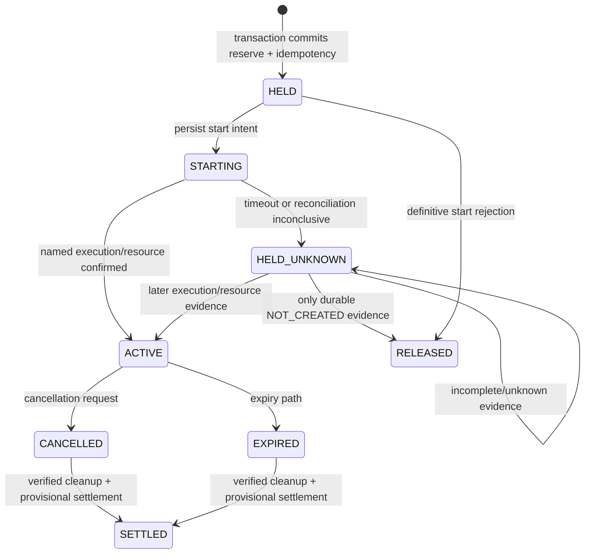
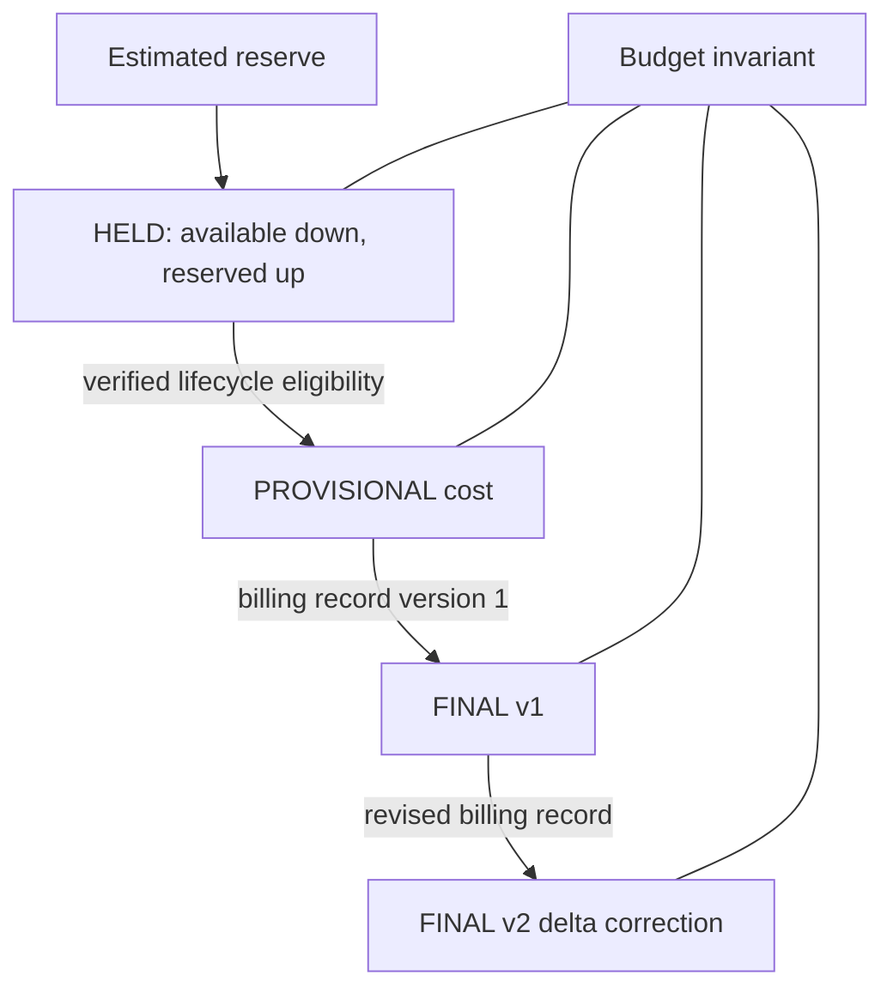

# SPENDCTL candidate technical disclosures

**Status:** internal invention-disclosure drafts for discussion only. They are not patent claims, legal advice, proof of novelty, or proof of live AWS behavior. See [patent novelty assessment](patent-novelty-assessment.md) for prior-art risks.

## Candidate 1 — Evidence-gated recovery of a cloud-spend reservation after ambiguous provisioning

### Problem

A cloud controller can receive an ambiguous result when it starts a workflow or provisions a resource. A network timeout can hide a successful action. Releasing the prior cost hold immediately risks a live resource with no reserved budget; repeating the action risks duplicate provisioning. Treating every failure as success permanently locks funds.

### Existing approaches and limitation

Database idempotency, workflow retry, and saga compensation are known. A generic retry or compensating transaction does not itself say which evidence makes it safe to release a pre-provisioning financial hold when the actual resource state is unknown.

### Proposed mechanism actually present in the repository

1. Atomically persist a `HELD` reservation and stable idempotency record before starting the workflow.
2. Derive a deterministic workflow execution name from the reservation ID.
3. Persist workflow-start intent, start the execution with that name, then reconcile an ambiguous response by listing/describing the execution.
4. If existence/input/status cannot be established, retain `UNKNOWN`; do not release the hold.
5. Persist instance and volume identifiers in the reservation and atomically map each resource ID to that reservation/team.
6. Permit a pre-launch release only on durable evidence that no resource was created; permit post-launch release only after verified cleanup under the encoded rules.
7. Retain a hold and raise/record a recoverable state for unknown launch/cleanup outcomes.

### Failure and recovery rules

| Failure | Repository response | Source evidence |
|---|---|---|
| Client timeout during workflow start | Reconcile deterministic execution; otherwise preserve `START_UNKNOWN`/hold | [`workflow_start.py:93`](../services/spendctl/workflow_start.py:93)-[`179`](../services/spendctl/workflow_start.py:179) |
| Same idempotency key, same request | Replay durable result | [`ledger.py:298`](../services/spendctl/ledger.py:298)-[`425`](../services/spendctl/ledger.py:425) |
| Same key, changed payload | Fingerprint conflict | [`test_ledger.py:120`](../tests/unit/test_ledger.py:120) |
| Start definitively rejected | Transition to a release-eligible state | [`test_api.py:318`](../tests/unit/test_api.py:318) |
| No evidence of resource creation | Release only after `NOT_CREATED` evidence | [`test_ledger.py:217`](../tests/unit/test_ledger.py:217) |
| Cleanup incomplete/unknown | Do not refund/release | [`test_ledger.py:292`](../tests/unit/test_ledger.py:292) |

### Technical effect and measurement

The intended technical effect is avoidance of duplicate resource creation and avoidance of releasing an application hold when the resource state cannot be established. A testable measurement would be: after induced client/worker timeout and repeated requests, count unique resource IDs per reservation, count releases made while an eventual resource exists, and time to eventual reconciliation. The repository only provides local fakes/Moto evidence; it has **no AWS measurement**.

### Supporting code and tests

- durable transaction/invariant: [`services/spendctl/ledger.py:298`](../services/spendctl/ledger.py:298)-[`425`](../services/spendctl/ledger.py:425);
- deterministic workflow reconciliation: [`services/spendctl/workflow_start.py:86`](../services/spendctl/workflow_start.py:86)-[`179`](../services/spendctl/workflow_start.py:179);
- immutable workflow/resource mapping: [`services/spendctl/ledger.py:829`](../services/spendctl/ledger.py:829)-[`986`](../services/spendctl/ledger.py:986);
- local tests: [`tests/unit/test_ledger.py:180`](../tests/unit/test_ledger.py:180), [`200`](../tests/unit/test_ledger.py:200), [`217`](../tests/unit/test_ledger.py:217), [`301`](../tests/unit/test_ledger.py:301), [`tests/unit/test_api.py:278`](../tests/unit/test_api.py:278).

### Potential differentiator and unresolved risk

The possible differentiator is the exact **evidence gate**: unknown start/launch holds until a deterministic workflow lookup and resource-attribution/cleanup evidence permit a defined transition. The risk is high because idempotency, deterministic operation names, sagas, compensation, and conservative retries are all familiar distributed-systems techniques. A formal search must test whether the combined rule set is disclosed or obvious.

## Candidate 2 — Versioned correction of a reservation-backed cloud-spend ledger after lifecycle evidence and delayed billing

### Problem

An estimate used to hold budget before provisioning can differ from actual billed cost. Resource lifecycle events can be delayed, duplicated, incomplete, or later corrected; billing exports can also arrive late or be revised. A controller needs to avoid double counting while retaining an auditable correction path.

### Proposed mechanism actually present in the repository

1. Store estimated reserve as integer micro-USD and move it from `available_micro` to `reserved_micro` when the request is admitted.
2. Move an eligible terminal reservation through a provisional settlement after lifecycle conditions are met.
3. Normalize and attribute billing rows to a reservation/resource ID, rejecting incomplete/ambiguous data under the code’s rules.
4. Apply a final settlement only with a next settlement version; calculate the delta from the prior provisional/final amount and mutate the budget atomically.
5. Replay the same settlement identifier/version idempotently and retain settlement-version records.

### Failure and recovery

| Condition | Repository rule |
|---|---|
| Replayed provisional settlement | Same settlement ID and cost returns replay result |
| Final settlement version out of order | Reject unless it is an exact prior replay |
| Overrun | Require alerts table and record the financial effect rather than silently cap it |
| Incomplete/ambiguous billing attribution | Billing code defines error paths; no live CUR evidence proves real input compatibility |
| Partial/unknown cleanup | Do not refund merely because cancellation was requested |

### Technical effect and measurement

The intended effect is idempotent, auditable convergence of an application ledger under billing revisions while preserving its balance invariant. Measure duplicate/revised-record processing, attribution conflicts, invariant violations, and difference between CUR-attributed charge and final ledger amount. The current evidence is fixture/Moto only; actual CUR delivery, schema, revisions, and attribution are unverified.

### Supporting evidence

- provisional and final settlement logic: [`services/spendctl/ledger.py:988`](../services/spendctl/ledger.py:988)-[`1180`](../services/spendctl/ledger.py:1180);
- billing normalization/reconciliation: [`services/spendctl/billing.py:85`](../services/spendctl/billing.py:85)-[`321`](../services/spendctl/billing.py:321);
- state/cleanup constraints: [`services/spendctl/lifecycle.py:48`](../services/spendctl/lifecycle.py:48)-[`235`](../services/spendctl/lifecycle.py:235);
- tests: [`tests/unit/test_ledger.py:324`](../tests/unit/test_ledger.py:324), [`tests/unit/test_billing.py:457`](../tests/unit/test_billing.py:457).

### Prior-art risk

This candidate is exposed to prior art on billing reconciliation, metering, revisioned ledgers, cost allocation, and generic transaction idempotency. It also has a Section 3(k) risk if the claim’s contribution is primarily accounting rather than a technical cloud-resource-state protocol. Treat it as a dependent feature of Candidate 1 unless a specialist search identifies a defensible technical distinction.

