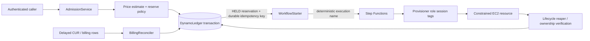

# SPENDCTL patent novelty and prior-art assessment

**Date:** 2026-10-22  
**Scope:** initial technical prior-art screen for an Indian filing decision. This is not a freedom-to-operate opinion, a complete patentability search, a legal opinion, or a claim chart. It does not establish that any reference is valid, enforceable, or prior art in a particular jurisdiction.

## 1. Executive verdict

**Do not take “a cloud budget controller” or “atomic budget reservation before EC2 provisioning” to a patent professional as a broad invention.** The repository combines well-known building blocks: conditional transactional accounting, API idempotency, an orchestrated saga with compensation, tag-constrained provisioning, lifecycle cleanup, and billing reconciliation. Public AWS material itself documents DynamoDB all-or-nothing transactions and idempotency, and Step Functions saga/compensation patterns. Published patent literature also squarely covers cloud-budget management, cost-aware provisioning, and idempotent provisioning.

There is nevertheless **one narrow candidate worth a preliminary discussion with an Indian patent professional only if the inventor can supply stronger evidence and a pre-filing search is commissioned**:

> A fail-closed, versioned cloud-spend state machine in which a durable application-budget hold is created before provisioning; a deterministic workflow identity is used to reconcile an ambiguous start; a hold cannot be released merely because a launch or cleanup response is missing; resource-to-reservation attribution is persisted; and a hold is settled or later corrected only after specified evidence states, including cleanup confirmation and delayed/revised billing data.

The strongest argument **for** that candidate is the particular evidence ordering and no-refund rules: `UNKNOWN` start/launch or incomplete cleanup preserves the hold, while a release requires durable `NOT_CREATED` evidence or confirmed cleanup. The ledger also uses versioned final settlement corrections. Those are concrete system-state rules, not merely a cost dashboard.

The strongest argument **against** it is that this looks like an expected application of standard transactional outbox/idempotency/saga/compensation and cloud-billing reconciliation techniques to an administrative budget problem. The current repository has no live AWS proof of the claimed technical effect, and the source is AWS-specific rather than a new resource-control primitive. Under Indian Patents Act section 3(k), characterizing the contribution as team budgeting, approval, or spend accounting creates a serious business-method/computer-program risk.

**Bottom-line recommendation:** preserve authorship and dated design/test material, avoid public disclosure of any not-yet-filed idea, and spend a short attorney consultation on the narrow state-machine candidate only. Do not spend money filing a broad application on the present implementation without a professional novelty/inventive-step search and a clearer technical effect than financial governance.

## 2. Evidence labels and repository coverage

| Label | Meaning in this report |
|---|---|
| Implemented | Present in source code. |
| Locally verified | Covered by recorded unit/Moto/fake tests or CDK synthesis. |
| AWS verified | Demonstrated by a real AWS operation. |

Repository review covered README, architecture/failure/evidence material, module acceptance, readiness report, verification log, core services, CDK stacks, and the focused ledger/API/provisioner/lifecycle/billing tests. It did not independently audit every frontend component or all generated templates.

The project is **implemented and locally verified in important areas, but not AWS verified end to end**. The readiness report records no deployed application stacks and no live Cognito/API/DynamoDB/Step Functions/EC2/CUR flow. See [README](../README.md), [module acceptance](../docs/module-acceptance.md), [verification log](../docs/verify-log.md), and [readiness report](spendctl-readiness-report.md).

## 3. Architecture and technical mechanism map

### Observed execution path

1. `AdmissionService.admit` validates identity/team, calculates a reserve, and calls the ledger before the workflow starter ([`services/spendctl/admission.py:120`](../services/spendctl/admission.py:120)).
2. `DynamoLedger.reserve` conditionally writes an idempotency record, a `HELD` reservation, and a budget update in one `TransactWriteItems` call ([`ledger.py:298`](../services/spendctl/ledger.py:298)-[`425`](../services/spendctl/ledger.py:425)). The update reduces `available_micro`, increases `reserved_micro`, and requires enough available budget.
3. `WorkflowStarter` records start intent and derives a deterministic Step Functions execution name ([`workflow_start.py:86`](../services/spendctl/workflow_start.py:86)-[`119`](../services/spendctl/workflow_start.py:119)). On ambiguous response, it lists/describes the execution; it returns `START_UNKNOWN` rather than treating a timeout as no execution ([`122`](../services/spendctl/workflow_start.py:122)-[`179`](../services/spendctl/workflow_start.py:179)).
4. CDK creates a permission-boundary-limited EC2 provisioner role and caller `sts:AssumeRole`/`sts:TagSession` controls ([`infra/stacks/foundation.py:487`](../infra/stacks/foundation.py:487)-[`577`](../infra/stacks/foundation.py:577)). The provisioner assumes the role with `reservation-id` and `team` session tags ([`services/spendctl/provisioner.py:359`](../services/spendctl/provisioner.py:359)).
5. Workflow outcome recording atomically binds discovered instance/volume resource IDs to the reservation and rejects conflicting mappings ([`ledger.py:829`](../services/spendctl/ledger.py:829)-[`986`](../services/spendctl/ledger.py:986)).
6. Release is deliberately restricted: an unstarted or definitively failed workflow may release ([`ledger.py:427`](../services/spendctl/ledger.py:427)-[`482`](../services/spendctl/ledger.py:482)); a pre-launch failure requires durable `NOT_CREATED` evidence; confirmed cleanup has a separate guarded path ([`ledger.py:483`](../services/spendctl/ledger.py:483)-[`748`](../services/spendctl/ledger.py:748)).
7. Lifecycle code requests cancellation, reaps resource records, verifies tags/ownership, and retains uncertainty for recovery ([`services/spendctl/lifecycle.py:48`](../services/spendctl/lifecycle.py:48)-[`235`](../services/spendctl/lifecycle.py:235)).
8. A provisional settlement moves a confirmed completed reservation from hold to spend; `final_settle` applies monotonically versioned billing corrections ([`ledger.py:988`](../services/spendctl/ledger.py:988)-[`1180`](../services/spendctl/ledger.py:1180)). The billing reconciler normalizes/attributes records and invokes ledger reconciliation ([`services/spendctl/billing.py:85`](../services/spendctl/billing.py:85)-[`321`](../services/spendctl/billing.py:321)).

### Local test evidence

The tests are meaningful design evidence, but use Moto/fakes and do not prove AWS semantics:

- concurrent requests do not overdraw the modelled budget: [`tests/unit/test_ledger.py:180`](../tests/unit/test_ledger.py:180);
- an unknown workflow start cannot release the hold: [`test_ledger.py:200`](../tests/unit/test_ledger.py:200);
- pre-launch release requires durable no-resource evidence: [`test_ledger.py:217`](../tests/unit/test_ledger.py:217);
- partial/unknown cleanup does not refund: [`test_ledger.py:292`](../tests/unit/test_ledger.py:292);
- ambiguous launch remains held even following tagged cleanup: [`test_ledger.py:301`](../tests/unit/test_ledger.py:301);
- provisional/final/corrected settlement is tested: [`test_ledger.py:324`](../tests/unit/test_ledger.py:324);
- API tests cover same-key replay/conflict and ambiguous workflow start: [`tests/unit/test_api.py:249`](../tests/unit/test_api.py:249), [`278`](../tests/unit/test_api.py:278);
- a same billing snapshot is applied once: [`tests/unit/test_billing.py:457`](../tests/unit/test_billing.py:457).

## 4. Candidate invention disclosures

### Candidate A — Atomic application-budget admission before cloud provisioning

**Technical problem.** Concurrent callers can admit costs above a team’s configured application budget if they read balance and then provision independently.

**Repository mechanism.** A transaction writes: (i) a long-lived application idempotency record keyed by team/key, (ii) a `HELD` reservation containing a request fingerprint, and (iii) conditional balance and open-reservation changes. A conflicting reused key is rejected; a repeated same request is reconciled from durable state. The asserted invariant is `available_micro + reserved_micro + spent_micro = budget_micro` ([`ledger.py:1`](../services/spendctl/ledger.py:1)-[`6`](../services/spendctl/ledger.py:6), [`298`](../services/spendctl/ledger.py:298)-[`425`](../services/spendctl/ledger.py:425)).

**Technical effect claimed by the code.** No two successful local-model admissions can oversell the configured ledger budget despite concurrent execution. It is an accounting consistency effect, not proof of lower network latency, EC2 safety, or AWS billing enforcement.

**Conventional/known elements.** Conditional database transactions, budget checking, durable idempotency records, and pre-provision cost estimates are known. DynamoDB directly documents atomic `TransactWriteItems` and request idempotency; AWS’s token is only ten minutes, while SPENDCTL’s separate record is a design choice rather than a demonstrated new database primitive.

**Assessment.** The broad candidate is weak for novelty and inventive step. A narrower claim could try to require the exact three-record transaction plus fingerprint-conflict semantics and later workflow evidence gates, but presently the “budget” is likely characterized as a business/accounting rule.

### Candidate B — Fail-closed recovery from ambiguous provisioning outcomes

**Technical problem.** After a successful budget hold, the caller can lose the Step Functions or EC2 response. Automatically refunding could permit a resource to exist without a corresponding hold; blindly retrying could duplicate resources.

**Repository mechanism.** It records a deterministic workflow name, persists `STARTING`, reconciles by listing/describing the named execution, and preserves `UNKNOWN` if reconciliation cannot establish the outcome. It does not release the hold based on a timeout. It later maps resource IDs to the reservation and gates release on a specific no-resource or cleanup state.

**Technical effect claimed by the code.** It preferentially creates a conservative temporary hold over a possible unaccounted resource, and prevents release when ownership/state evidence is incomplete.

**Conventional/known elements.** Deterministic operation identifiers, retry reconciliation, idempotent provisioning, saga compensation, and fail-safe handling of ambiguous distributed outcomes are known techniques. The closest direct cloud material is AWS’s saga guidance and its idempotency/retry guidance; US20230139969A1 explicitly addresses idempotent resource provisioning and remediation after provisioning errors.

**Assessment.** This is the strongest candidate only at the **precise evidence-gate combination** level. It has moderate implementation specificity, low-to-moderate apparent novelty confidence, and low apparent inventive-step confidence until a focused patent search tests that exact sequence.

### Candidate C — Lifecycle/settlement state machine with delayed billing correction

**Technical problem.** A request’s estimated reserve, observed resource lifecycle, and later billing export can disagree, arrive out of order, or be revised.

**Repository mechanism.** A held reservation becomes provisionally settled after an eligible terminal lifecycle state; final settlement records a version and adjusts the amount by delta. The billing component normalizes input, attributes it using reservation/resource data, checks completeness, and sends a versioned correction to the ledger.

**Technical effect claimed by the code.** It preserves a single application-ledger balance invariant while admitting delayed corrections; it does not prove actual invoice accuracy.

**Conventional/known elements.** Usage/billing reconciliation, tag/resource attribution, revisions, idempotent ledger updates, and audit records are longstanding. SPENDCTL has no live CUR schema or billing export evidence, so its exact input semantics are unproven.

**Assessment.** Weak as a standalone candidate. It may be a dependent feature of Candidate B, but broad billing reconciliation is likely crowded and vulnerable to being framed as financial administration.

### Candidate D — Session-tag-scoped provisioning and verified cleanup

**Technical problem.** A workflow should only create/clean resources attributable to its reservation/team and should avoid broad execution permissions.

**Repository mechanism.** Caller and trust policies restrict two STS session tags; EC2 request conditions require matching principal/request tags, fixed region/SKU/network rules, and no public IP. Cleanup checks ownership tags before acting.

**Assessment.** Security architecture and least-privilege configuration, not a promising independent patent candidate. AWS IAM ABAC and session tags are product mechanisms; a patent claim merely applying them is unlikely to be technically distinctive.

## 5. Search methodology and coverage

**Search date:** 2026-10-22. Searches were conducted through general web search and opened primary pages where available. The investigation did not obtain authenticated access to WIPO PATENTSCOPE, Espacenet, USPTO Patent Center, or IP India’s patent database. No legal-status or Indian-family verification was completed. Therefore this is a screening search, not a clearance or invalidity search.

| Query / source | What was examined | Limitation |
|---|---|---|
| `cloud resource provisioning budget reservation idempotency patent` / Google Patents via web search | Cloud-reservation/cost-control patent results | Search-engine coverage; not a classification search. |
| `cloud cost management resource provisioning budget control patent` / Google Patents | Budget management and cost-estimation patents | No claim-by-claim prosecution review. |
| `cloud billing reconciliation revised billing records resource tags` / Google Patents | Billing/reconciliation and tagged-resource material | No complete date/family validation. |
| `cloud resource lifecycle cleanup idempotent provisioning failure` / Google Patents | Provisioning recovery/idempotency/reclamation | Exact SPENDCTL combination not exhaustively queried. |
| DynamoDB transaction/idempotency; AWS saga docs | Official platform documentation | Establishes known components, not necessarily anticipation. |
| Indian Patents Act / CRI guidance / IP India | Official statutory and examination sources | Guidance must be applied by counsel to eventual claims. |

## 6. Prior-art and technical-reference list

1. **US20110313902A1, “Budget Management in a Compute Cloud,”** publication 2011-12-22. It calculates current/estimated cloud charges, compares them with an allocated budget, and selects/implements policies. [Google Patents](https://patents.google.com/patent/US20110313902A1/en).
2. **US11347559B2, “Cost estimation for a cloud-based infrastructure provisioning system,”** publication 2022-05-31 (confirm in a formal search). It estimates infrastructure-provisioning costs from a plan/configuration. [Google Patents](https://patents.google.com/patent/US11347559B2/en).
3. **US11416296B2, “Selecting an optimal combination of cloud resources within budget constraints,”** publication 2022-08-16 (confirm in a formal search). Claim 1 filters resource combinations against a remaining safe budget and provisions a selection. [Google Patents](https://patents.google.com/patent/US11416296B2/en).
4. **US20160380906A1, “Hybrid cloud resource scheduling,”** publication 2016-12-29. Its claims compare a VM budget with admission prices, score placements, then deploy. [Google Patents](https://patents.google.com/patent/US20160380906A1/en).
5. **US20230139969A1, “Idempotent resource management system provisioning,”** publication 2023-05-04. It describes retry-safe provisioning and remediation based on error/operation type. [Google Patents](https://patents.google.com/patent/US20230139969A1/en).
6. **US10467055B2, “Computer resource provisioning failure mitigation,”** publication 2019-11-05 (confirm in a formal search). Search results identify a provisioning workflow with recovery operations. [Google Patents](https://patents.google.com/patent/US10467055B2/en).
7. **AWS DynamoDB transaction documentation,** current accessed 2026-10-22. It describes all-or-nothing writes and idempotent transaction tokens. [AWS documentation](https://docs.aws.amazon.com/amazondynamodb/latest/developerguide/transaction-apis.html).
8. **AWS Saga pattern guidance,** current accessed 2026-10-22. It describes maintaining distributed consistency using compensating transactions and Step Functions orchestration. [AWS Prescriptive Guidance](https://docs.aws.amazon.com/prescriptive-guidance/latest/modernization-data-persistence/saga-pattern.html).
9. **US20260057320A1, “Systems and methods of facilitating intelligent budget governance for a cloud resource,”** publication 2026-02-26. It is relevant to the field but is likely too late to be novelty prior art if SPENDCTL’s effective filing date precedes publication; it may still identify older priority/family material to investigate. [Google Patents](https://patents.google.com/patent/US20260057320A1/en).

Items 2, 3, and 6 need their dates, legal status, family members, claims, and priority relevance verified in a professional search. Item 9 is included as a lead, **not** as automatically citable prior art.

## 7. Feature-by-feature comparison

| Candidate / essential feature | Closest reference(s) | Already disclosed | Possible distinction in SPENDCTL | Initial result |
|---|---|---|---|---|
| Budget-aware provisioning admission | US20110313902A1; US11416296B2; US20160380906A1 | Budget comparison/control; budget-constrained resource selection/placement/deployment | A durable, concurrent application-budget hold rather than selection or forecast control | Distinction exists at a narrow implementation level; broad concept not novel-looking. |
| Atomic hold + same-key replay/conflict | DynamoDB transaction docs | Atomic multi-item writes and idempotency tokens | Separate durable team-key fingerprint record, reservation and balance mutation in one transaction | Likely implementation of known transactions/idempotency; needs exact prior-art search. |
| Ambiguous start does not release | AWS saga guidance; US20230139969A1 | Saga compensation; idempotent provisioning/retry remediation | Deterministic execution identity + reconciliation + hold-preservation + later resource mapping | Best candidate, but likely obvious combination risk. |
| Cleanup-gated release and later financial correction | AWS saga guidance; cloud billing/reconciliation literature | Compensation/recovery; billing/usage reconciliation | Specific rule that `UNKNOWN` launch remains held even after a tagged cleanup report; versioned final corrections | Potentially specific, but current effect/evidence is limited to local tests. |
| Session-tag ABAC provisioning/cleanup | AWS IAM/STS architecture (not exhaustively searched) | Tag-based access control and session tags | Matching reservation/team principal/request/resource tags and cleanup verification | Security policy composition; likely conventional. |

### Novelty versus inventive step

For **novelty**, the relevant question is whether one earlier disclosure contains every essential limitation of a properly drafted claim. This screening did not find one reference expressly describing the complete Candidate B sequence. That is not a positive novelty conclusion because the search was incomplete.

For **inventive step**, the problem is harder: AWS publicly teaches transactions/idempotency and saga compensation, while patents teach budget-aware cloud provisioning and idempotent resource provisioning. A reviewer may regard combining them to protect a budget hold during uncertain provisioning as an ordinary skilled-engineer design response.

## 8. Indian patentability considerations

Indian law defines an invention as a new product or process involving inventive step and capable of industrial application; it defines inventive step in terms of technical advance/economic significance and non-obviousness. See [Patents Act section 2](https://www.ipindia.gov.in/acts/patent-act-1970/section-2-5). Section 3(k) excludes “a mathematical or business method or a computer programme per se or algorithms”; see the official [section 3 page](https://ipindia.gov.in/acts/patent-act-1970/section-3).

IP India’s current resource page lists the **2025 CRI Guidelines**, and its official material explains that novelty, inventive step, industrial applicability, sufficiency, and excluded subject matter are examined separately. [IP India CRI resources](https://ipindia.gov.in/resource/patents-resources-guidelines).

Applied cautiously:

- **Highest risk:** claims framed as allocating team money, approving spend, forecasting budget, or reconciling bills. Those look like a business method even if implemented in software.
- **Potentially better framing:** a computer-implemented resource-control protocol that makes specific service-operation decisions from durable evidence states, prevents duplicate cloud-resource creation, and guarantees a defined consistency property through database/workflow transitions.
- **Not enough on its own:** saying the system “has a technical effect,” uses AWS, or has an EC2 resource does not resolve section 3(k). The effect must be supported by the claimed technical mechanism and not be an accounting result dressed up as technology.
- **Sufficiency:** a filing would need clear state definitions, allowed transitions, invariant/conditions, deterministic execution-name construction, reconciliation queries, failure matrix, and examples. The current repo is a useful start but lacks deployed measurements and a provider-agnostic explanation.
- **Ownership/public disclosure:** identify every human contributor, employment/assignment terms, open-source provenance, and every public disclosure. Public repository/document disclosures before filing can be harmful; obtain India-specific advice before posting a detailed invention disclosure or demo materials.

## 9. Ranked shortlist

Scores are 1 (weak/absent) to 5 (strong). They are comparative screening judgments, not grant probabilities.

| Candidate | Implemented evidence | Distinction from closest art | Potential novelty | Potential inventive step | Technical specificity/effect | Indian eligibility | Tests/evidence | Confidence | Initial recommendation |
|---|---:|---:|---:|---:|---:|---:|---:|---:|---|
| B — fail-closed ambiguous-provisioning recovery | 4 | 2 | 2 | 2 | 3 | 2 | 4 | 2 | **Investigate narrowly** |
| C — lifecycle + versioned settlement correction | 4 | 2 | 2 | 1 | 3 | 1 | 3 | 2 | Runner-up only as dependent feature |
| A — atomic budget admission | 5 | 1 | 1 | 1 | 2 | 1 | 4 | 4 | Too conventional/budget-facing alone |
| D — session-tag-constrained provision/cleanup | 4 | 1 | 1 | 1 | 2 | 2 | 3 | 3 | Too configuration-specific alone |

## 10. Evidence that could change the ranking

1. A professional search that finds no earlier disclosure of the exact evidence-gated state machine, including Step Functions execution reconciliation plus tag-verified resource cleanup plus settlement-version logic.
2. Real AWS tests showing measurable prevention of duplicate instance creation or unbacked budget release across induced start/timeout/late-resource scenarios. Local Moto/fake tests cannot establish service semantics.
3. A technical comparison showing why stock DynamoDB transaction idempotency and standard saga compensation cannot achieve the same result without the disclosed state/condition structure.
4. A claim-ready, provider-agnostic technical problem/effect. “Budget control” must be separated from the actual resource-state consistency protocol.
5. A dated contributor/ownership and disclosure record.

## 11. Recommended next steps before counsel

1. Freeze a dated source snapshot and prepare a contributor/assignment list; do not treat this report as an invention filing.
2. Ask an Indian patent professional for a **narrow prior-art search** around Candidate B, using synonyms such as *durable budget hold*, *ambiguous provisioning response*, *deterministic workflow identity*, *resource-attribution mapping*, *cleanup-gated release*, and *versioned cloud-billing correction*.
3. Give counsel the state diagram and the exact source/test evidence in [patent-candidate-disclosures.md](patent-candidate-disclosures.md), plus known prior art from this report.
4. Obtain a fresh decision on public disclosure before publishing a live demo or full detailed design. The repository and existing documents may already be a disclosure issue; counsel must assess facts and dates.
5. If counsel sees promise, run a bounded AWS experiment that records technical outcomes without exposing credentials or account identifiers. Do not make patent assertions from the result alone.

## 12. Limitations and confidence

This report is deliberately adverse to novelty. It did not search all jurisdictions/databases, inspect file histories or inventorship, validate patent legal status/family dates, or construct claims. Some cited patent dates should be verified from official records. The report relies on current repository source and recorded local evidence; it does not claim live AWS functionality. Confidence is **moderate** that broad SPENDCTL concepts are conventional, **low** that Candidate B is novel/inventive, and **low** regarding Indian patent eligibility without counsel.

